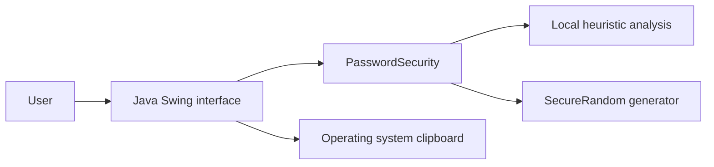

# PassGuard — Password Strength Analyzer

PassGuard is a standalone Java Swing desktop application for locally estimating password strength and generating random password candidates. It is an educational aid, not an authentication service or a guarantee of security.

## Abstract and introduction

People often reuse short or predictable passwords and have little feedback when choosing a replacement. PassGuard demonstrates a local desktop approach: it evaluates length, character variety, common-password matches and simple patterns, then explains its score and offers practical suggestions. A configurable generator produces candidates with selected character groups.

## Problem statement and objectives

The project explores how a desktop tool can give understandable, immediate feedback without sending a user's input to a server. Its objectives are to provide an explainable 0–7 estimate, identify a small set of obvious risks, generate random candidates with category guarantees, and demonstrate privacy-conscious handling in a Java application.

## Existing and proposed system

The original implementation combined Swing UI and analysis logic in one class, used a fixed 16-character generator, and could show a score that did not match a warning-driven “Weak” rating. The current version extracts the logic into `PasswordSecurity`, uses a documented score and aligned rating bands, exposes generator options, and keeps processing on the local machine.

## Features

- Local password analysis, with a show/hide control and clear/reset action.
- A score from 0 to 7 and matching Weak, Moderate, Strong or Very Strong rating.
- Explanation of length, variety and pattern contributions.
- Checks for a small built-in common-password list, runs of four identical characters, and ascending or descending alphanumeric sequences.
- Personalized suggestions and a five-item input checklist.
- `SecureRandom` based generator, configurable from 8 to 128 characters, with optional uppercase, lowercase, digit and symbol groups. Each selected group is guaranteed to appear; positions are shuffled.
- Clipboard copy with feedback and a warning that clipboard contents may persist.

## Technology stack and requirements

- Java 17 or later (the implementation uses modern Java APIs such as `Set.of`).
- Swing and AWT; no runtime libraries, server, database or network access.
- PowerShell on Windows for the included test runner, or equivalent `javac`/`java` commands.

## Architecture



Analysis is local. Clipboard access occurs only when the user requests copying a generated value.

## Algorithm

The estimator awards up to four points for length (1 at 8–11 characters, 2 at 12–15, 3 at 16–19, and 4 at 20+) and up to three for character variety (one point for each additional category after the first, capped at three). A match in the local common-password list sets the score to zero. A repeated run or a four-character ascending/descending alphanumeric sequence deducts one point each. The result is clamped to 0–7. The UI maps 0–2 to Weak, 3–4 to Moderate, 5–6 to Strong and 7 to Very Strong.

This simple heuristic is deliberately explainable. It does not estimate cracking time or entropy, model targeted attacks, detect password reuse, query breach data, or determine whether an account has been compromised. Character variety is only one component; length gets the larger share of the score. See [SECURITY.md](SECURITY.md).

## Project structure

```text
PassGuard/
├── src/main/java/
│   ├── PasswordAnalyzer.java
│   └── PasswordSecurity.java
├── src/test/java/
│   └── PasswordSecurityTest.java
├── docs/
│   └── PROJECT_REPORT.md
├── run-tests.ps1
├── README.md
├── SECURITY.md
└── .gitignore
```

## Build and run

Install a JDK 17 or later, then from the repository root run:

```powershell
javac --release 17 -encoding UTF-8 src\main\java\PasswordSecurity.java src\main\java\PasswordAnalyzer.java
java -cp src\main\java PasswordAnalyzer
```

The first command places `.class` files beside the sources; `.gitignore` excludes them. Alternatively, compile to a separate output directory:

```powershell
New-Item -ItemType Directory -Force target\classes
javac --release 17 -encoding UTF-8 -d target\classes src\main\java\PasswordSecurity.java src\main\java\PasswordAnalyzer.java
java -cp target\classes PasswordAnalyzer
```

## Tests

Run `.\run-tests.ps1` in PowerShell. The dependency-free test suite compiles the production code and checks empty and short values, single and mixed character groups, a long passphrase, common/repeated/sequential patterns, score boundaries and classifications, recommendations, generator length and category guarantees, invalid selections, and sample variation. It exercises the logic without opening a window; clipboard and visual interaction require a desktop session.

## Limitations

The local blocklist is intentionally small and is not a breached-password database. Pattern checks cover simple runs only. The score is a teaching heuristic, not a standards-compliant meter or a guarantee. Java strings cannot be reliably erased from memory; the UI clears the retrieved character array, but the Swing field and temporary immutable string may remain in memory until reclaimed. Clipboard managers and other applications may retain copied values. The analyzer has no account context and cannot detect reuse.

## Future enhancements

- Add a larger curated local blocklist with clear licensing and maintenance notes.
- Evaluate the meter against published, documented password-strength datasets.
- Improve keyboard-walk and date-pattern detection without overclaiming coverage.
- Add UI accessibility and layout checks on multiple operating systems.
- Consider a passphrase generator based on a documented word list.

## Academic report

See [docs/PROJECT_REPORT.md](docs/PROJECT_REPORT.md) for the detailed project report.
