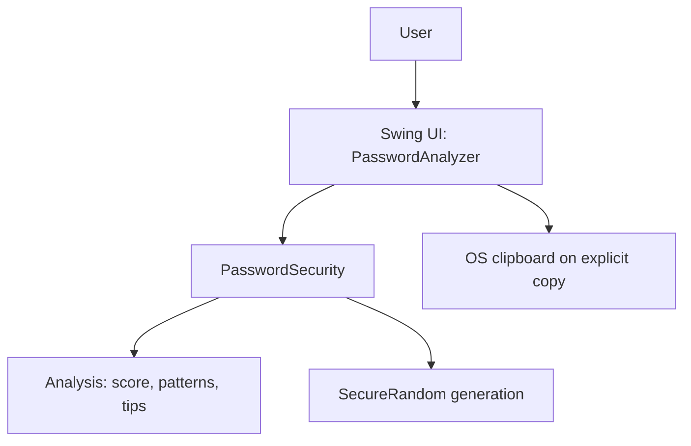

# PassGuard — Password Strength Analyzer

## 1. Abstract

PassGuard is a Java Swing desktop project that locally estimates password strength and generates random password candidates. The analyzer reports a 0–7 heuristic score, a matching rating, detected simple patterns, and suggestions. Password data is not sent to a service or saved by the application. A configurable generator uses `SecureRandom` and guarantees representation of selected character groups. The project demonstrates desktop UI design, separation of logic, basic automated testing and privacy limitations. Its meter is educational and does not guarantee security.

## 2. Introduction

Passwords remain a familiar authentication mechanism, but users often receive little useful feedback when choosing them. A strength indicator can explain common weaknesses and encourage unique, longer choices. This project implements that interaction as a self-contained desktop application, with analysis separated from its Swing presentation so the rules can be exercised independently.

## 3. Problem definition

The initial version offered a score based on thresholds and character classes, but applied weak ratings separately when it found common or patterned values. As a result, the displayed number and category could conflict. Its generator had a fixed length and fixed character set. The project goal is to make the estimate explainable and internally consistent, provide configurable generation, and state accurately what local checks can and cannot establish.

## 4. Objectives

1. Provide immediate local feedback about length, character variety and a few predictable patterns.
2. Align displayed score and strength category and explain the score.
3. Generate candidates using `SecureRandom`, optional character groups and a configurable length.
4. Keep password processing local and avoid password storage or logging.
5. Provide repeatable automated checks for analysis and generator behavior.

## 5. Literature and background overview

Password meters simplify a complicated, context-dependent security question into feedback a user can act on. A simple meter cannot account for all guessing strategies, password reuse, leaked credentials, service rate limits, or a user's personal context. Current NIST digital identity guidance emphasizes length, blocklists of common/expected/compromised passwords, and avoiding composition rules for verifier policy. PassGuard is not a verifier and does not implement a complete blocklist; its variety points are retained as an educational signal and its generator offers optional categories. These details must not be mistaken for NIST conformance.

## 6. System requirements

### Functional

- Accept a password in a masked field with optional reveal.
- Calculate a bounded score and corresponding category.
- Identify configured common-password matches, runs of four repeated characters, and four-character ascending/descending alphanumeric sequences.
- Explain score contributions and offer suggestions.
- Generate a candidate of a chosen length and selected categories, then copy it on user request.
- Clear the analysis and generated preview.

### Non-functional

- Run as a standalone desktop application.
- Process analysis locally and avoid password persistence and logging.
- Keep analysis logic testable without opening the UI.
- Communicate that heuristic results are not guarantees.

## 7. Software and hardware requirements

- Software: Java Development Kit (JDK) 17 or later; a desktop environment for Swing UI; PowerShell for the provided Windows test command.
- Hardware: a general-purpose desktop capable of running a supported Java runtime. No special hardware or network connection is needed for application functionality.

## 8. System architecture

The UI obtains the input from `JPasswordField`, calls the local analysis helper, and renders returned values. The generator uses a static `SecureRandom` instance. Clipboard access is performed only by the copy button. There is no server, persistence layer or network component.

## 9. Module descriptions

- **src/main/java/PasswordAnalyzer.java:** Main Swing window, shared hero, navigation host and privacy footer.
- **src/main/java/AnalyzerPage.java:** Password input, show/hide, analysis action, score meter and checklist.
- **src/main/java/InsightsPage.java:** Analysis-specific pattern findings, score explanation, recommendations and empty state.
- **src/main/java/GeneratorPage.java:** Length and category options, local candidate display, generation, copy and reset behavior.
- **src/main/java/NavigationBar.java:** Exactly three page controls, responsive page layout and fade transition.
- **src/main/java/AnimatedBackground.java** and **GlassUI.java:** Java2D wave/particle background and reusable glass cards, buttons, icons and styling.
- **src/main/java/PasswordSecurity.java:** common-password list, repeated/sequential checks, score calculation, rating bands, explanatory reasons and generator.
- **PasswordSecurityTest.java:** dependency-free automated checks for core behavior.
- **run-tests.ps1:** compiles production and test classes into ignored `target/test-classes` and runs the test main class.

## 10. Algorithm and implementation

### Analysis score

Length awards four possible points: 1 at 8–11 characters, 2 at 12–15, 3 at 16–19 and 4 at 20 or more. Character variety awards up to three additional points: no variety point for one category, then one point for each additional category. Four groups are considered: uppercase, lowercase, digits and non-alphanumeric characters. The score is capped at seven.

An exact case-insensitive match against the embedded common-password list sets the score to zero. A run of at least four identical characters and an ascending or descending sequence of four alphanumeric characters each deduct one point. The score is clamped to 0–7. Classification is Weak (0–2), Moderate (3–4), Strong (5–6), and Very Strong (7). The same final score determines category, so the numeric score and category agree by construction.

### Generation

The caller selects length and any combination of uppercase, lowercase, digits and symbols. One uniformly selected character from each enabled group is inserted first. Remaining positions are selected from the combined enabled alphabet; the list is shuffled using `SecureRandom`. Invalid length/category combinations are rejected. UI length is 8–128; the helper accepts 1–128 when the number of required categories fits.

### Suggestions

Suggestions encourage at least 12 characters, uniqueness, and avoiding matched patterns. They are intended as practical feedback rather than security certification. The score is a lightweight heuristic, not entropy or cracking-time calculation.

## 11. User interface description

The app uses a navy glassmorphism theme with a floating three-item navigation bar and custom animated cyan/violet waves. The Analyser page exclusively contains the masked input, score meter and five-point checklist. Insights exclusively presents analysis findings and recommendations, with an empty state before analysis. Generate exclusively contains length and category controls, password preview and copy/reset actions. Pages use separate Swing components within a `CardLayout`; analysis state is passed to Insights and retained on page switches. Layouts adapt to narrower widths and use vertical scrolling where page content needs it. Clipboard feedback remains inline.

## 12. Testing methodology

The dependency-free test runner compiles the application logic and test source, then runs assertions without a graphical window. Cases include empty/short inputs; lower, upper, numeric, symbol-only and mixed values; a long passphrase; common, repeated and sequential patterns; score bounds and classification; suggestions; configured generator length; category requirements; invalid options; and sample variation. The UI, clipboard, and visual layout are not exercised by this automated suite.

## 13. Results and discussion

The code now routes UI calculations through one `Analysis` result, eliminating the previous separate warning-based category override. The generator enforces the chosen groups and shuffles characters. On the project machine, `run-tests.ps1` completed successfully with 41 assertions, and production sources compiled with `javac --release 17`. These checks cover the logic and compilation, not visual UI behavior or clipboard interaction. A static `SecureRandom` instance supports the generation path, but this project makes no claim of formal cryptographic review.

## 14. Limitations

The common list is small and embedded. Pattern checks are intentionally narrow. No breach database or online service is used, so compromised-password detection is absent. The meter does not model password reuse, contextual guesses, keyboard patterns, or attacker-specific knowledge. Java and Swing may retain immutable string copies in memory; overwriting one returned `char[]` does not guarantee erasure. Clipboard managers may retain copied values. UI tests were not performed as part of the logic test harness.

## 15. Future enhancements

- Use a larger, legally reviewed and maintainable local blocklist.
- Evaluate scoring against documented public datasets and usability studies.
- Add accessible keyboard navigation, contrast review and automated multi-size UI checks.
- Consider a memorable passphrase generator with a documented word list.
- Evaluate a character-array based analysis API to reduce temporary immutable copies, while acknowledging Swing's own input handling.

## 16. Conclusion

PassGuard demonstrates local password analysis and random candidate generation in Java Swing. The updated logic has consistent score bands, length-forward points, simple predictable-pattern deductions, explanations and test coverage. Its local and educational scope is explicit: users still need unique credentials and the meter cannot certify a password as secure.

## 17. References

1. National Institute of Standards and Technology, *Digital Identity Guidelines: Authentication and Lifecycle Management*, SP 800-63B, current revision. [NIST SP 800-63B](https://pages.nist.gov/800-63-4/sp800-63b.html).
2. National Institute of Standards and Technology, *SP 800-63B Implementation Resources: FAQs*. [NIST implementation FAQs](https://pages.nist.gov/800-63-4-Implementation-Resources/faqs/index.html).
3. Oracle, *Java Platform Standard Edition API Specification*, `java.security.SecureRandom`. [SecureRandom API](https://docs.oracle.com/en/java/javase/17/docs/api/java.base/java/security/SecureRandom.html).

These references provide background for password policy and the Java API; they do not imply that PassGuard conforms to NIST requirements.
